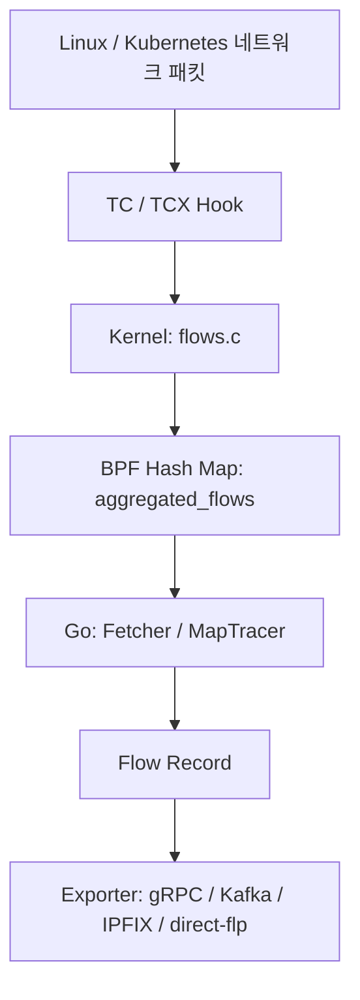
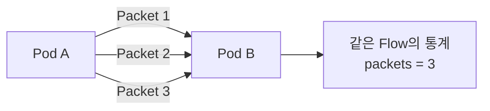
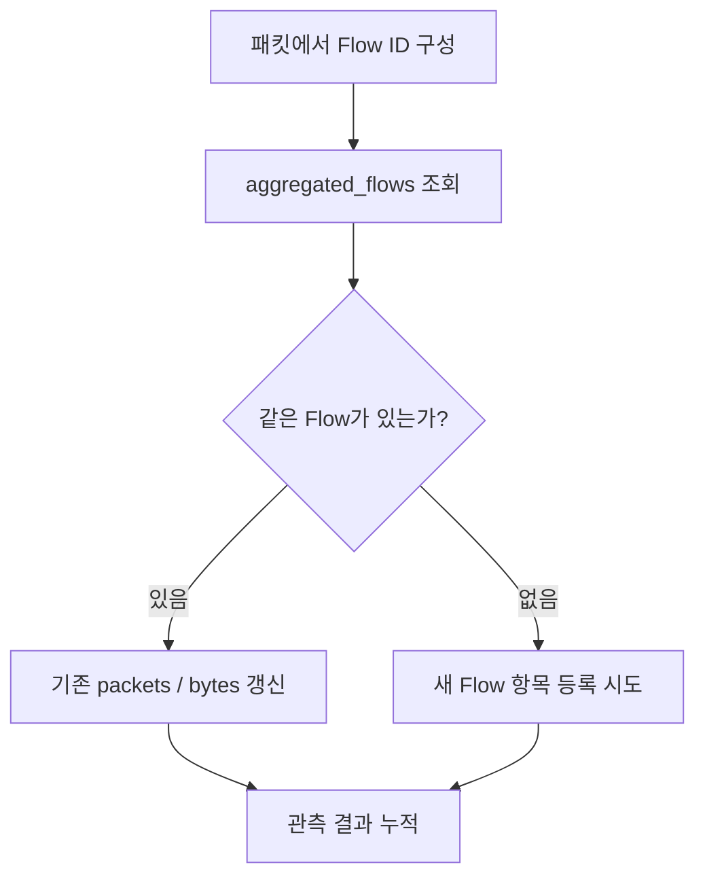

## 1. NetObserv eBPF Agent를 선택한 이유

『Learning eBPF』를 공부하면서 eBPF 프로그램의 **Hook**, **BPF Map**, **Kernel Space와 User Space의 데이터 전달**을 배웠다. 하지만 실제 오픈소스에서는 이 기능들이 어떻게 연결되는지 궁금했다.

Kubernetes에서 Pod가 `Running`이라고 해도 네트워크 통신이 정상이라는 뜻은 아니다. 네트워크에서 실제로 어떤 통신이 발생했는지 살펴볼 수 있는 프로젝트를 찾다가 [NetObserv eBPF Agent](https://github.com/netobserv/netobserv-ebpf-agent)를 선택했다.

## 2. NetObserv는 어떤 오픈소스인가?

NetObserv는 Linux/Kubernetes 네트워크를 관측하기 위한 프로젝트다. 여러 구성요소 중 이번에 분석한 것은 **네트워크 데이터를 실제로 수집하는 `netobserv-ebpf-agent`**이다.

| 구성요소 | 역할 |
|---|---|
| [netobserv-ebpf-agent](https://github.com/netobserv/netobserv-ebpf-agent) | eBPF로 네트워크 정보 수집·집계 |
| [flowlogs-pipeline](https://github.com/netobserv/flowlogs-pipeline) | 수집된 Flow 데이터를 처리하는 후속 구성요소 |
| [netobserv-operator](https://github.com/netobserv/netobserv-operator) | Kubernetes 환경의 배포·설정 관리 |

Agent에는 **Flow Capture(기본)**와 **Packet Capture** 두 모드가 있다. 이번 글에서는 `ENABLE_PCA=false`인 **Flow Capture**만 분석했다. Packet Capture 모드는 별도 eBPF 프로그램(`bpf/packets/packets.c`)을 사용한다.

## 3. 전체 동작 구조부터 보기


*NetObserv의 기본 Flow Capture 경로를 간단히 나타낸 그림. 실제 Hook과 출력 경로는 설정에 따라 달라진다.*



이 구조에서 역할이 나뉜다.

- **Kernel Space:** 패킷을 관측하고 같은 통신의 정보를 BPF Map에 누적한다.
- **User Space(Go Agent):** Map에 누적된 값을 주기적으로 가져와 정리하고 외부로 전달한다.

참고로 NetObserv는 **네트워크 통신 자체를 연결하는 CNI가 아니라, 통신 정보를 관측하는 Agent**다.

## 4. 실제로 살펴본 파일

전체 소스코드를 모두 읽기보다, **패킷 관측 → Flow 집계 → User Space 전달** 경로에 해당하는 파일을 따라갔다.

```text
netobserv-ebpf-agent/
├── bpf/
│   ├── flows/flows.c              # 패킷 관측과 Flow 집계
│   ├── types.h                    # flow_id, flow_metrics 정의
│   └── maps_definition.h          # BPF Map 정의
├── pkg/
│   ├── flow/tracer_map.go         # Map 수집 주기, Record 변환
│   ├── tracer/flows/fetcher.go    # BPF Map 조회 및 삭제
│   └── agent/flows/agent.go       # Agent 구성, Exporter 선택
└── docs/
    ├── architecture.md
    └── flows/architecture.md
```

### 4-1. Packet과 Flow의 차이

**Packet**은 실제 네트워크를 지나는 개별 데이터이고, **Flow**는 출발지·목적지 주소, 포트, 프로토콜 등 공통 정보로 구분한 통신 흐름이다.



예를 들어 같은 Flow에 속하는 패킷이 3개 관측되면, NetObserv는 이를 반드시 세 개의 별도 레코드로 보내기보다 **하나의 Flow 통계에 누적**할 수 있다. 위 예시는 샘플링이나 중복 관측 조건을 제외한 단순한 설명이다.

## 5. Kernel Space: 패킷을 관측하고 Flow를 집계한다

### 5-1. TC Hook에서 eBPF 프로그램 실행

**파일:** [`bpf/flows/flows.c`](https://github.com/netobserv/netobserv-ebpf-agent/blob/main/bpf/flows/flows.c)

```c
SEC("classifier/tc_ingress")
int tc_ingress_flow_parse(struct __sk_buff *skb) {
    return flow_monitor(skb, INGRESS);
}

SEC("classifier/tc_egress")
int tc_egress_flow_parse(struct __sk_buff *skb) {
    return flow_monitor(skb, EGRESS);
}
```

패킷이 해당 인터페이스의 TC Ingress/Egress 지점에 도착하면 연결된 eBPF 프로그램이 실행된다. 두 진입점은 공통 함수인 `flow_monitor()`를 호출한다. 현재 코드에는 TCX와 Netkit용 진입점도 있다.

`flow_monitor()`는 패킷의 길이, 관측 시각, 헤더 정보 등을 확인하고, 설정에 따른 샘플링·필터링을 거친 뒤 Flow 정보를 처리한다.

### 5-2. 어떤 통신인지, 얼마나 통신했는지 구분

**파일:** [`bpf/types.h`](https://github.com/netobserv/netobserv-ebpf-agent/blob/main/bpf/types.h)

| 구조체 | 저장하는 정보 | 역할 |
|---|---|---|
| `flow_id` | 출발지·목적지 IP, 포트, 프로토콜, ICMP 정보 | **어떤 통신인가?** |
| `flow_metrics` | 패킷 수, 바이트 수, 관측 시각, 인터페이스 등 | **얼마나 관측했는가?** |

이를 저장하는 Map은 다음과 같이 선언되어 있다.

**파일:** [`bpf/maps_definition.h`](https://github.com/netobserv/netobserv-ebpf-agent/blob/main/bpf/maps_definition.h)

```c
struct {
    __uint(type, BPF_MAP_TYPE_HASH);
    __type(key, flow_id);
    __type(value, flow_metrics);
    // ...
} aggregated_flows SEC(".maps");
```

즉 `aggregated_flows`는 **Flow ID를 Key로, Flow 통계를 Value로 사용하는 BPF Hash Map**이다.

### 5-3. 이미 기록한 통신이라면 통계를 갱신

```c
flow_metrics *aggregate_flow =
    (flow_metrics *)bpf_map_lookup_elem(&aggregated_flows, &id);

if (aggregate_flow != NULL) {
    update_existing_flow(aggregate_flow, &pkt, len,
                         flow_sampling, skb->ifindex, direction, &tls);
} else {
    // 새로운 Flow 항목 생성 및 Map 등록
}
```

*설명을 위해 `else` 내부의 상세 코드는 생략했다.*



여기서 패킷을 여러 인터페이스에서 중복 관측할 수 있다는 점도 고려한다. `update_existing_flow()`는 **처음 관측한 인터페이스를 기준으로 주요 패킷·바이트 통계를 갱신**한다. 또한 여러 CPU가 같은 통계를 수정할 때 충돌하지 않도록 Lock을 사용한다.

처음에는 Map을 단순한 Key–Value 저장소로만 생각했는데, 실제 코드를 보니 **같은 통신을 묶고 통계를 관리하는 데 사용**하고 있었다.

## 6. User Space: BPF Map의 데이터를 가져온다

여기서부터는 Go 코드다. 핵심은 **Map에 쌓인 데이터를 누가 가져가느냐**이다.

### 6-1. `MapTracer`가 주기적으로 수집을 요청

**파일:** [`pkg/flow/tracer_map.go`](https://github.com/netobserv/netobserv-ebpf-agent/blob/main/pkg/flow/tracer_map.go)

```go
flows := m.mapFetcher.LookupAndDeleteMap(m.metrics)
```

`MapTracer`는 설정된 주기에 따라 Flow 수집을 요청한다. 가져온 데이터는 `model.Record` 형태로 변환하고, Go Channel을 통해 다음 처리 단계로 전달한다.

### 6-2. `Fetcher`가 실제 Map 항목을 조회·삭제

**파일:** [`pkg/tracer/flows/fetcher.go`](https://github.com/netobserv/netobserv-ebpf-agent/blob/main/pkg/tracer/flows/fetcher.go)

```go
flowMap := m.objects.AggregatedFlows

if err := flowMap.LookupAndDelete(&id, &baseMetrics); err != nil {
    // 오류 처리
}
```

이 코드는 기본 Flow Map의 **한 항목을 읽고 삭제**한다. 이렇게 데이터를 꺼내면 Map에 새 통계를 다시 쌓을 공간을 확보할 수 있다. 지원되지 않는 환경을 위한 기존(Legacy) 방식도 준비되어 있다.

DNS, Packet Drop 등의 기능을 활성화했다면 별도 Map에서 가져온 추가 정보를 Flow 데이터에 합치는 처리도 수행한다.

### 6-3. 어디로 전달할까?

**파일:** [`pkg/agent/flows/agent.go`](https://github.com/netobserv/netobserv-ebpf-agent/blob/main/pkg/agent/flows/agent.go)

설정에 따라 `gRPC`, `Kafka`, `IPFIX`, `direct-flp` 같은 Export 방식을 선택한다. 실제 데이터는 후속 Collector나 Flowlogs Pipeline 등에서 처리할 수 있다.

## 7. 코드를 읽으며 발견한 특징

| 특징 | 소스에서 확인한 내용 |
|---|---|
| **Flow 단위 집계** | 패킷마다 전달하는 대신 Hash Map에 통계를 누적 |
| **중복 관측 고려** | 최초 관측 인터페이스를 기준으로 주요 카운터 갱신 |
| **동시 실행 고려** | 여러 CPU의 Map 갱신을 위한 Lock 및 등록 경쟁 처리 |
| **전달 실패 대비** | 새 Flow를 Map에 넣지 못한 일부 상황에서 설정에 따라 Ring Buffer 사용 |

특히 Ring Buffer는 **모든 패킷의 기본 전달 경로가 아니라**, Flow Map 등록 실패에 대응하는 보조 경로로 사용될 수 있다는 점이 인상적이었다.


## 8. 정리

이번 분석을 통해 **패킷을 관측하는 것과 Flow 데이터를 만드는 것은 서로 다른 단계**라는 것을 이해했다.

1. eBPF 프로그램이 TC/TCX Hook에서 패킷을 관측한다.
2. 패킷의 공통 식별 정보로 같은 Flow인지 판단한다.
3. BPF Map에 패킷 수와 바이트 수 등을 누적한다.
4. Go Agent가 주기적으로 데이터를 가져와 Record로 변환하고 내보낸다.

『Learning eBPF』에서 공부한 **Hook, BPF Map, Kernel/User Space 구분**이 실제 오픈소스에서 어떻게 연결되는지 확인할 수 있었다. 앞으로는 테스트 환경에서 Agent를 실행해 Flow가 실제로 어떻게 출력되는지도 검증해 보고 싶다.
