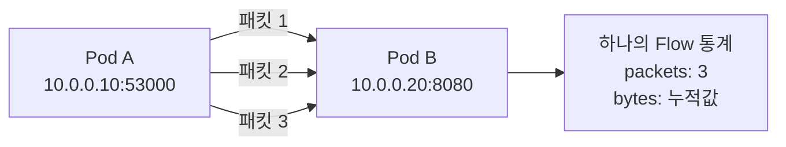
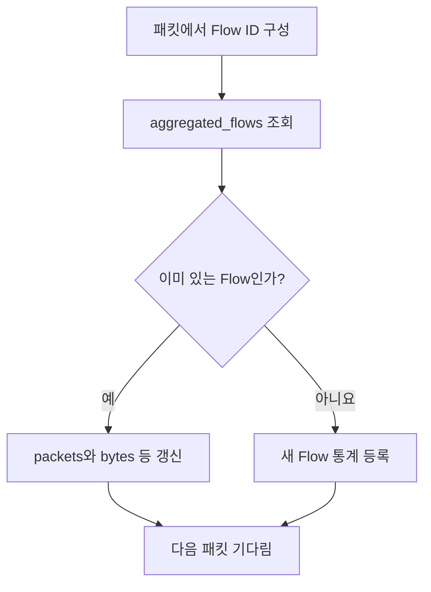

## 1. NetObserv 오픈소스를 선택 이유

『Learning eBPF』를 공부하면서 다음 개념들을 배웠다.

- eBPF 프로그램은 커널의 특정 **Hook**에서 실행된다.
- **BPF Map**에 데이터를 저장하거나 공유할 수 있다.
- 커널에서 수집한 정보를 **User Space**로 전달할 수 있다.

그런데 이 개념들이 실제 운영 도구에서 **어떻게 연결되는지** 궁금했다.

Kubernetes에서 Pod가 `Running`이어도 통신이 정상이라는 뜻은 아니다. 서비스 연결이 느리거나 끊길 때 실제 네트워크에서 무슨 일이 일어나는지 확인해야 한다. 이런 상황에 활용할 수 있는 eBPF 기반 네트워크 관측 프로젝트가 **NetObserv**다.

**이번에 알고 싶은 것:** *“NetObserv는 네트워크 패킷을 관측해서 어떻게 사람이 활용할 수 있는 Flow 정보로 바꿀까?”*

## 2. NetObserv 오픈소스의 레파지토리 비교 - eBPF Agent 레파지토리 선택

NetObserv는 **네트워크 관측을 위한 전체 프로젝트**다. GitHub Repository가 여러 개 보이는 이유는 역할을 나누어 개발하기 때문이다.

| Repository | 담당 역할 | 이번 분석 |
|---|---|---|
| [`netobserv-operator`](https://github.com/netobserv/netobserv-operator) | Kubernetes 배포·설정 관리 | 구성 이해만 |
| **[`netobserv-ebpf-agent`](https://github.com/netobserv/netobserv-ebpf-agent)** | **커널에서 네트워크 Flow 수집** | **핵심 분석** |
| [`flowlogs-pipeline`](https://github.com/netobserv/flowlogs-pipeline) | 수집 데이터 가공·전달 | 연결 관계만 |
| Web Console 관련 구성요소 | 데이터 조회·시각화 | 코드 분석 제외 |

이 중 `netobserv-ebpf-agent`를 선택한 이유는 **실제 eBPF C 프로그램이 들어 있기 때문**이다. 다른 컴포넌트까지 모두 분석하면 범위가 너무 넓어져, 이번 과제의 목적과 멀어진다.

### 전체 동작 구조를 그림으로 보기


*Pod의 통신을 TC Hook에서 관측하고 BPF Map에 집계한 후 Go Agent가 읽어 내보내는 흐름. 이해를 위한 개념도이며 실제 인터페이스와 출력 경로는 설정에 따라 달라진다.*

**중요한 점:** NetObserv가 네트워크 통신을 직접 연결하는 것은 아니다. 통신을 **관측해서 기록**한다. Kubernetes의 Cilium CNI처럼 패킷 전달을 담당하는 시스템과 역할이 다르다.

## 3. GitHub에서 실제로 어디를 봤을까?

전체 파일을 처음부터 끝까지 읽기보다 **패킷 하나가 Flow 통계로 변하는 과정**을 따라갔다.

```text
netobserv-ebpf-agent/
├── bpf/
│   ├── flows.c             ← TC Hook, 패킷 처리, Flow 갱신
│   ├── types.h             ← Flow ID와 통계 구조체
│   ├── maps_definition.h   ← BPF Map 정의
│   ├── utils.h             ← 패킷 헤더 처리 관련 함수
│   ├── dns_tracker.h       ← DNS 관련 확장 기능
│   ├── pkt_drops.h         ← Packet Drop 관련 확장 기능
│   └── rtt_tracker.h       ← TCP RTT 관련 확장 기능
├── pkg/                    ← Go User Space 코드
└── docs/architecture.md    ← 공식 구조 설명
```

| 실제로 살펴본 부분 | 확인하려고 한 질문 | 얻은 결론 |
|---|---|---|
| `flows.c`의 TC 프로그램 | 언제 eBPF가 실행될까? | Ingress/Egress 패킷을 Hook에서 관측 |
| `flow_monitor()` | 패킷에서 무엇을 읽을까? | 시각, 길이, 헤더 등 처리 |
| `types.h`의 `flow_id` | 같은 통신인지 어떻게 알까? | 주소·포트·프로토콜 등으로 구별 |
| Flow 갱신 코드 | 왜 BPF Map을 쓸까? | 같은 Flow의 통계를 누적 |
| Ring Buffer 분기 | Map 저장이 실패하면? | 설정에 따라 보조 전달 경로 사용 |
| 공식 아키텍처 | 정보는 사용자에게 어떻게 갈까? | Go Agent가 Map/Ring Buffer 데이터를 수집 |

> 이번 글에서 **직접 코드 발췌를 읽고 설명하는 중심 파일은 `flows.c`와 `types.h`**다. Map 정의 및 Go 내부의 전체 호출 흐름은 공식 문서와 연결해 이해했다. 모든 보조 파일을 줄 단위로 분석한 것은 아니다.

## 4. 분석 ① 패킷과 Flow는 왜 구분할까?

코드를 보기 전에 **Packet(패킷)**과 **Flow(통신 흐름)**의 차이를 먼저 정리했다.



- **Packet:** 네트워크를 지나는 개별 데이터 단위
- **Flow:** 주소·포트·프로토콜 등 공통 기준을 갖는 패킷을 묶어 본 통신 단위

**확인한 점:** 패킷이 여러 개 발생했다고 해서 기록해야 할 Flow도 그만큼 생기는 것은 아니다. NetObserv는 같은 Flow의 통계를 한곳에 누적한다.

## 5. 분석 ② eBPF 프로그램은 어디에서 실행될까? — `flows.c`

[소스코드: `bpf/flows.c`](https://github.com/netobserv/netobserv-ebpf-agent/blob/main/bpf/flows.c)

```c
SEC("classifier/tc_ingress")
int tc_ingress_flow_parse(struct __sk_buff *skb) {
    return flow_monitor(skb, INGRESS);
}

SEC("classifier/tc_egress")
int tc_egress_flow_parse(struct __sk_buff *skb) {
    return flow_monitor(skb, EGRESS);
}
```

처음 눈에 들어온 것은 거의 같은 함수가 **Ingress와 Egress로 두 개** 있다는 점이었다.

| 코드 | 의미 |
|---|---|
| `SEC("classifier/tc_ingress")` | 들어오는 패킷을 처리할 TC 프로그램의 Section |
| `SEC("classifier/tc_egress")` | 나가는 패킷을 처리할 TC 프로그램의 Section |
| `struct __sk_buff *skb` | 패킷 정보를 다루기 위한 eBPF Context |
| `flow_monitor(...)` | 실제 Flow 처리 로직을 공통 함수로 연결 |

**분석 결과:** eBPF는 계속 패킷을 찾아다니는 것이 아니라, **TC Hook에 연결되어 해당 지점에 패킷이 도착하면 실행**된다. `SEC()`는 프로그램의 Section을 정의하고 로더가 이를 인식하는 데 활용된다.

**교재 연결:** Chapter 3의 Program Section, Chapter 7의 Program/Attachment Type, Chapter 8의 TC.

## 6. 분석 ③ 패킷에서 무엇을 가져올까? — `flow_monitor()`

`flows.c`의 공통 처리 함수에서는 다음 값들을 준비한다.

```c
pkt.current_ts = bpf_ktime_get_ns();
void *data_end = (void *)(long)skb->data_end;
void *data = (void *)(long)skb->data;
struct ethhdr *eth = (struct ethhdr *)data;
u64 len = skb->len;
```

| 가져오는 정보 | 사용 목적 |
|---|---|
| 관측 시각 | 통신을 언제 봤는지 기록 |
| `data` | 패킷 데이터의 시작 위치 |
| `data_end` | 접근 가능한 패킷 데이터의 끝 |
| Ethernet Header | 상위 프로토콜을 파악할 단서 |
| 패킷 길이 | Flow별 바이트 통계 집계 |

**왜 `data_end`까지 필요할까?** 패킷이 기대한 길이보다 짧다면 헤더를 읽는 과정에서 허용 범위를 벗어날 수 있다. 따라서 패킷의 범위를 확인해야 한다. 『Learning eBPF』 Chapter 6의 Verifier와 관련된 부분이다.

```c
if (fill_ethhdr(eth, data_end, &pkt, &eth_protocol) == DISCARD) {
    return TC_ACT_OK;
}
```

여기서 새롭게 알게 된 점은 **`DISCARD`가 나왔다고 무조건 네트워크 패킷을 버리는 것은 아니라는 것**이다. 해당 분기는 이 패킷의 **관측·분석을 여기서 종료**하며, `TC_ACT_OK`는 패킷 Drop 명령이 아니다.

**분석 결과:** 네트워크를 통과시키는 동작과, 관측 프로그램이 어떤 패킷을 기록할지 결정하는 동작은 구분해야 한다.

## 7. 분석 ④ 같은 통신인지 어떻게 판단할까? — `types.h`

[소스코드: `bpf/types.h`](https://github.com/netobserv/netobserv-ebpf-agent/blob/main/bpf/types.h)

```c
typedef struct flow_id_t {
    u8 src_ip[IP_MAX_LEN];
    u8 dst_ip[IP_MAX_LEN];
    u16 src_port;
    u16 dst_port;
    u8 transport_protocol;
    u8 icmp_type;
    u8 icmp_code;
} flow_id;
```

`flow_id`는 **어떤 Flow인지 구별하기 위한 Key**다.

| 필드 | 쉬운 의미 |
|---|---|
| `src_ip`, `dst_ip` | 어디에서 어디로 통신하는가? |
| `src_port`, `dst_port` | 어떤 포트를 사용하는가? |
| `transport_protocol` | TCP인가, UDP인가? |
| `icmp_type`, `icmp_code` | ICMP라면 어떤 종류인가? |

일반적으로 배우는 *5-tuple*과 비슷하지만, 이 구조체에는 ICMP를 구분하는 필드도 있다.

**분석 결과:** NetObserv는 ‘패킷 A, 패킷 B’를 따로 세는 데서 그치지 않고, **같은 통신을 식별할 기준을 먼저 만든다.**

## 8. 분석 ⑤ 통신 기록을 어디에 저장할까? — BPF Map

`flows.c`에서 `aggregated_flows`라는 Map을 조회한다.

```c
flow_metrics *aggregate_flow =
    (flow_metrics *)bpf_map_lookup_elem(&aggregated_flows, &id);
```

이 코드에서 `id`는 Flow를 구별하는 Key다. 반환된 값이 있으면 **이미 관측한 Flow**, 없으면 **새로 관측한 Flow**로 처리할 수 있다.



### BPF Map을 표로 생각해 보면

| Key: `flow_id` | Value: `flow_metrics` |
|---|---|
| A → B / TCP / 포트 정보 | 패킷 수, 바이트 수, 처음·마지막 관측 시각 등 |
| A → C / UDP / 포트 정보 | 별도의 패킷 수, 바이트 수, 관측 시각 등 |

**분석 결과:** 교재에서는 BPF Map을 Key-Value 자료구조라고 배웠다. 이 프로젝트에서는 **네트워크 통신별 누적 통계**를 저장하는 데 사용한다. Map의 역할이 훨씬 구체적으로 이해되었다.

## 9. 분석 ⑥ 왜 중복 집계와 동시 실행을 고려할까?

이미 존재하는 Flow라면 다음과 같은 갱신 로직이 사용된다.

```c
bpf_spin_lock(&aggregate_flow->lock);
if (aggregate_flow->if_index_first_seen == if_index) {
    aggregate_flow->packets += 1;
    aggregate_flow->bytes += len;
    aggregate_flow->end_mono_time_ts = pkt->current_ts;
}
bpf_spin_unlock(&aggregate_flow->lock);
```

코드를 읽으면서 두 가지를 확인했다.

- **`if_index_first_seen` 확인:** 하나의 통신이 여러 인터페이스에서 관측될 수 있으므로, 주요 카운터의 중복 누적을 줄이려는 처리다.
- **`bpf_spin_lock()` 사용:** 여러 CPU가 같은 통계를 동시에 바꿀 때 충돌하지 않도록 보호한다.

새로운 Flow를 등록할 때도 `BPF_NOEXIST`를 이용하고, 다른 실행 경로가 먼저 같은 Key를 등록한 경우 `-EEXIST`를 다루는 로직이 있다.

**분석 결과:** 실제 eBPF 코드는 ‘데이터를 읽고 저장한다’는 기능만으로 끝나지 않는다. **중복 관측과 여러 CPU의 동시 실행**까지 고려해야 한다.

## 10. 분석 ⑦ Kernel에서 수집한 데이터는 어떻게 밖으로 나올까?

공식 [Architecture 문서](https://github.com/netobserv/netobserv-ebpf-agent/blob/main/docs/architecture.md)를 통해 Kernel과 User Space의 역할을 연결해서 살펴봤다.

| 위치 | 하는 일 |
|---|---|
| **Kernel Space / eBPF** | 패킷을 관측하고 Flow별 통계 집계 |
| **BPF Map** | 집계된 정보를 저장 |
| **Go User Space Agent** | Map에서 데이터를 읽어 처리·전달 |
| **Flowlogs Pipeline 등** | 설정에 따라 데이터를 가공하거나 외부 시스템에 출력 |

또한 일부 Map 삽입 실패 상황을 처리하는 **Ring Buffer 보조 경로**도 소스에서 확인할 수 있다. 다만 ‘모든 패킷을 Ring Buffer로 보낸다’는 구조는 아니다. 이 경로 역시 설정과 Buffer 여유에 영향을 받는다.

**분석 결과:** eBPF 프로그램이 화면 출력까지 전부 담당하는 것이 아니라, **Kernel에서는 수집·집계하고 User Space에서는 읽기·가공·전달을 맡는 구조**다.

## 11. 정리

| 처음 가졌던 질문 | 소스코드를 살펴보고 내린 결론 |
|---|---|
| 언제 eBPF가 실행될까? | TC Ingress/Egress Hook에 연결된 프로그램이 패킷을 관측한다. |
| 같은 통신인지 어떻게 알까? | `flow_id`에 주소·포트·프로토콜 정보를 담아 구분한다. |
| 패킷이 많으면 어떻게 처리할까? | `aggregated_flows` Map에서 Flow별 통계를 누적한다. |
| 정확하게 집계하려면? | 여러 인터페이스의 중복 관측과 CPU 동시 실행을 고려한다. |
| 데이터를 밖에서는 어떻게 볼까? | Go Agent가 커널의 Map/Ring Buffer 데이터를 읽는다. |

**가장 크게 이해한 것은 “패킷을 관측한다”와 “Flow 통계를 만든다”는 것이 다른 단계라는 점이다.** NetObserv는 패킷 정보에서 공통 식별자를 만들고, 이를 바탕으로 같은 통신을 묶어 기록한다.

### Kubernetes 운영과 연결해서 느낀 점

Kubernetes에서 네트워크 장애를 만나면 보통 Pod 상태, Service, Endpoint, NetworkPolicy 등을 확인한다. 그런데 이것만으로는 실제 네트워크에서 무엇이 관측되었는지 부족할 수 있다.

이번 소스 분석을 통해 **관측 도구가 어떤 정보를 제공할 수 있는지뿐 아니라, 그 정보가 어떤 커널 지점에서 만들어졌는지 알아야 결과를 올바르게 해석할 수 있다**는 점을 배웠다.

예를 들어 NetObserv의 Flow 정보가 존재한다고 해서 애플리케이션 요청이 성공한 것은 아니다. Cilium/Hubble, 애플리케이션 로그, Service 상태 등 다른 정보와 함께 판단해야 한다. 반대로 특정 Flow가 없더라도 관측 인터페이스, 필터, 샘플링, 버퍼 손실 등의 가능성을 확인해야 한다.

또 Cilium도 eBPF 기반이므로, 실습에서는 같은 인터페이스의 TC/TCX 프로그램 연결 관계를 검증해야 한다. **운영 클러스터가 아닌 테스트 환경에서 먼저 확인하는 이유**도 이해할 수 있었다.

---

### 참고 자료

- [NetObserv eBPF Agent 공식 저장소](https://github.com/netobserv/netobserv-ebpf-agent)
- [bpf/flows.c](https://github.com/netobserv/netobserv-ebpf-agent/blob/main/bpf/flows.c)
- [bpf/types.h](https://github.com/netobserv/netobserv-ebpf-agent/blob/main/bpf/types.h)
- [bpf/maps_definition.h](https://github.com/netobserv/netobserv-ebpf-agent/blob/main/bpf/maps_definition.h)
- [공식 아키텍처 문서](https://github.com/netobserv/netobserv-ebpf-agent/blob/main/docs/architecture.md)
- Liz Rice, *Learning eBPF*, Chapters 2–8
