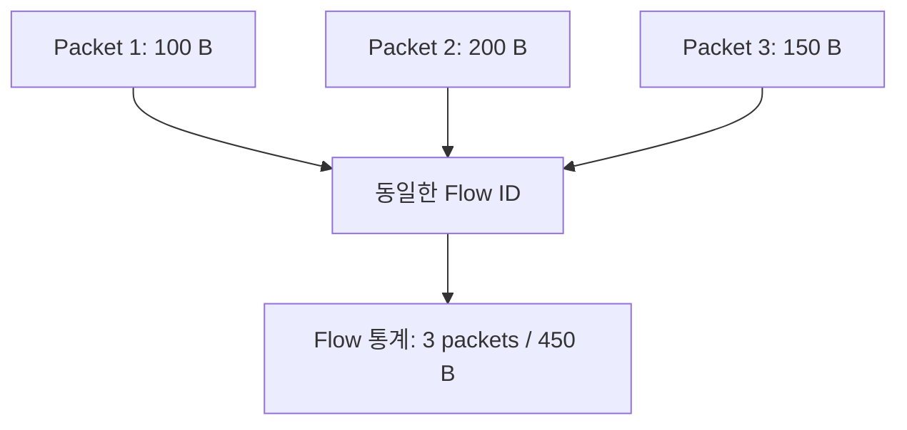
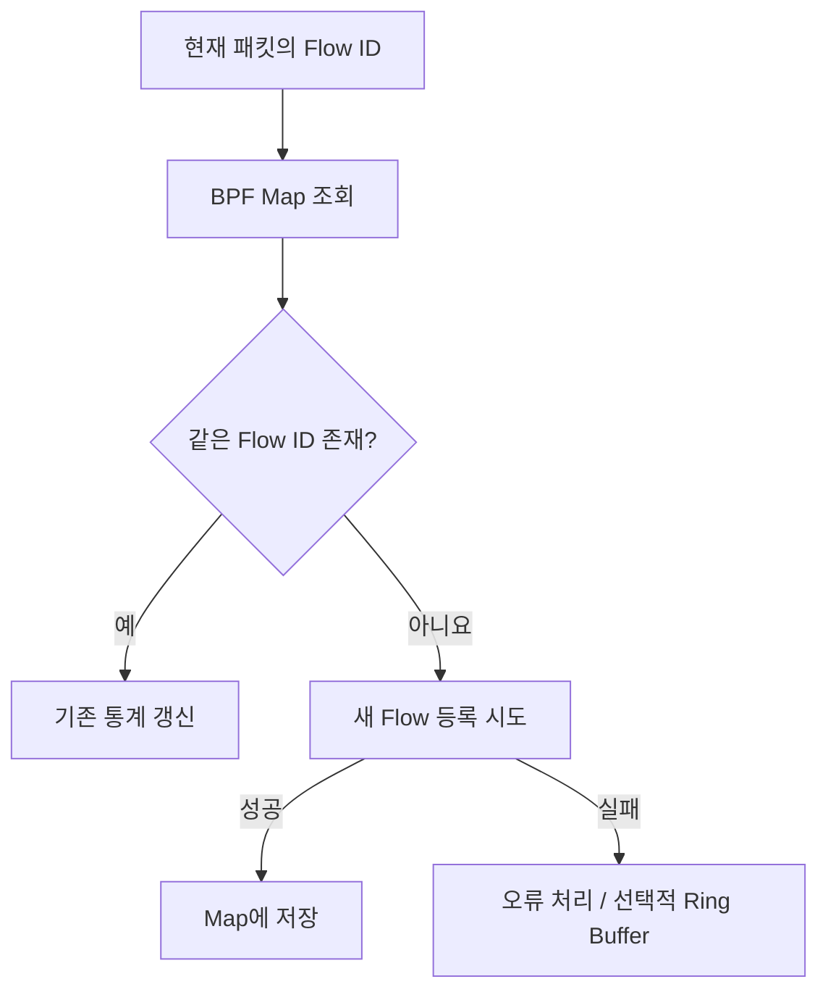
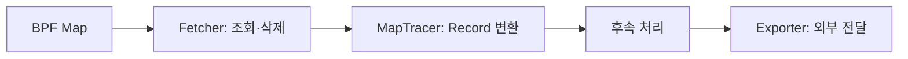

## 1. NetObserv eBPF Agent를 선택한 이유

『Learning eBPF』에서 **Hook, BPF Map, Kernel Space와 User Space**를 배웠다. 그런데 실제 오픈소스에서는 이 개념들이 어떻게 연결되어 동작하는지 궁금했다.

Kubernetes에서 Pod가 `Running`이어도 통신이 정상이라는 뜻은 아니다. 실제로 어떤 IP와 포트 사이에서 트래픽이 발생했는지 관측하는 방법을 공부하기 위해 [NetObserv eBPF Agent](https://github.com/netobserv/netobserv-ebpf-agent)를 선택했다.

이번에는 모든 기능을 분석하기보다 **패킷이 Flow 통계로 바뀌고 User Space로 전달되는 경로**를 직접 따라가 봤다.

## 2. NetObserv는 어떤 오픈소스인가?

NetObserv는 Linux/Kubernetes 환경에서 네트워크 통신을 관측하기 위한 프로젝트다. 그중 `netobserv-ebpf-agent`는 eBPF를 이용해 네트워크 정보를 수집하는 구성요소다.

| 구성요소 | 역할 |
|---|---|
| [`netobserv-ebpf-agent`](https://github.com/netobserv/netobserv-ebpf-agent) | eBPF로 패킷 관측 및 Flow 집계 |
| [`flowlogs-pipeline`](https://github.com/netobserv/flowlogs-pipeline) | 수집된 Flow의 후속 처리 |
| [`netobserv-operator`](https://github.com/netobserv/netobserv-operator) | Kubernetes 배포와 설정 관리 |

Agent에는 **Flow Capture(기본, `ENABLE_PCA=false`)**와 **Packet Capture(`ENABLE_PCA=true`)**가 있다. 두 모드는 서로 다른 eBPF 오브젝트를 사용한다. 이번 글은 `bpf/flows/flows.c`를 사용하는 Flow Capture만 다룬다.

> NetObserv Agent는 패킷을 전달하는 CNI가 아니라 **이미 발생하는 네트워크 통신을 관측하는 도구**다.

## 3. 패킷이 Flow 데이터가 되는 전체 과정

NetObserv eBPF Agent의 실제 코드를 분석하기 전에 전체 동작 구조부터 살펴봤다.


위 그림은 NetObserv의 기본 **Flow Capture 모드**를 나타낸 개념도다. 총 7개의 구간으로 나뉘어 있지만, 크게 보면 다음 4단계로 이해할 수 있다.

### 3-1. 네트워크 트래픽 발생과 패킷 관측 (①~③)

Kubernetes에서 Pod A가 Pod B로 HTTP 요청을 보내면 네트워크 패킷이 발생한다.

패킷은 Linux의 네트워크 경로를 따라 이동하며, 네트워크 인터페이스에 연결된 **TC/TCX Hook**에서 eBPF 프로그램이 패킷을 관측할 수 있다.

- **Ingress:** 네트워크 인터페이스로 패킷이 들어오는 방향
- **Egress:** 네트워크 인터페이스에서 패킷이 나가는 방향
- **TC Hook:** 네트워크 패킷을 처리하는 지점으로, eBPF 프로그램을 연결할 수 있다.

### 3-2. Kernel Space에서 Flow 통계 집계 (④~⑤)

`bpf/flows/flows.c`의 `flow_monitor()`는 패킷의 헤더를 분석해 출발지·목적지 IP, 포트, 프로토콜 등 통신을 구분할 정보를 확인한다.

이 정보를 바탕으로 **Flow ID**를 구성하고, `aggregated_flows`라는 BPF Hash Map에서 같은 Flow가 존재하는지 조회한다.

- **기존 Flow가 있으면:** 패킷 수와 바이트 수 등의 통계를 갱신한다.
- **새로운 Flow라면:** 통계 정보를 생성해 Map에 등록한다.

즉, NetObserv는 패킷을 관측할 때마다 개별 기록을 User Space로 전송하기보다 **Kernel에서 먼저 같은 통신의 통계를 누적**한다.

### 3-3. User Space에서 Flow 데이터 수집 (⑥)

Go로 작성된 Agent는 설정된 주기에 따라 BPF Map에 누적된 Flow 데이터를 가져온다.

`MapTracer`가 수집 작업을 요청하고, `Fetcher`가 실제 Map 항목을 조회·삭제한다.

가져온 데이터는 `model.Record`로 변환되어 다음 처리 단계로 전달된다.

또한 기본 Flow Map에 새로운 항목을 등록하지 못한 일부 상황에서는 설정에 따라 Ring Buffer를 보조 전달 경로로 사용할 수 있다.

### 3-4. Flow 데이터 외부 전달 및 활용 (⑦)

수집된 Flow Record는 Exporter를 통해 외부 시스템으로 전달할 수 있다.

NetObserv는 설정에 따라 **gRPC, Kafka, IPFIX, direct-flp** 등의 출력 방식을 지원한다.

전달된 정보는 Flow Logs, 트래픽 통계, 네트워크 통신 분석 및 시각화 등에 활용될 수 있다. 다만 실제 시각화는 후속 구성요소가 담당할 수 있다.

### Packet과 Flow는 어떻게 다를까?

- **Packet:** 네트워크를 지나는 개별 데이터 단위
- **Flow:** 출발지·목적지 IP, 포트, 프로토콜 등의 정보로 구분한 통신 흐름

예를 들어 동일한 Flow에 속하는 패킷 3개가 관측되었다고 가정해 보자.



실제 NetObserv는 같은 Flow의 패킷 수와 바이트 수를 BPF Map에 누적한다.

따라서 **Flow 단위 집계란 같은 통신에 속하는 여러 패킷의 정보를 하나의 통계로 묶어 관리하는 방식**이라고 이해할 수 있다.

위 수치는 샘플링과 중복 관측을 제외한 가상의 예시다.

이런 구조를 사용하는 이유는 매 패킷마다 User Space로 이벤트를 전달하는 부담을 줄이기 위해서다. 관련 설계 배경은 공식 `docs/ebpf_implementation.md`에서도 확인할 수 있었다.

이제 이 흐름이 실제 소스코드에서 어떻게 구현되었는지 살펴보겠다.


## 4. 분석한 소스코드

```text
netobserv-ebpf-agent/
├── bpf/
│   ├── flows/flows.c             # TC Hook, 패킷 처리, Flow 집계
│   ├── types.h                   # flow_id / flow_metrics 구조체
│   └── maps_definition.h         # BPF Map 정의
├── pkg/
│   ├── flow/tracer_map.go        # 수집 주기 및 Record 변환
│   ├── tracer/flows/fetcher.go   # BPF Map 조회·삭제
│   └── agent/flows/agent.go      # Agent 구성 및 Exporter 선택
└── docs/
    ├── architecture.md
    ├── flows/architecture.md
    └── ebpf_implementation.md
```

코드 전체를 설명하기보다는 **각 파일에서 데이터가 다음 단계로 이동하는 지점**을 중심으로 살펴봤다.

## 5. Kernel Space: 패킷을 관측하고 Flow를 집계한다

### 5-1. 패킷이 들어오면 어떤 함수가 실행될까? — `flows.c`

[소스코드: `bpf/flows/flows.c`](https://github.com/netobserv/netobserv-ebpf-agent/blob/main/bpf/flows/flows.c)

```c
SEC("classifier/tc_ingress")
int tc_ingress_flow_parse(struct __sk_buff *skb) {
    return flow_monitor(skb, INGRESS);
}

SEC("classifier/tc_egress")
int tc_egress_flow_parse(struct __sk_buff *skb) {
    return flow_monitor(skb, EGRESS);
}
```

- **Ingress / Egress:** 네트워크 인터페이스로 들어오는 방향 / 나가는 방향
- **`SEC(...)`:** eBPF 프로그램이 컴파일된 오브젝트의 어느 Section에 배치되는지 지정
- **`__sk_buff *skb`:** 패킷에 관한 정보에 접근하는 Context
- **`flow_monitor()`:** 두 방향에서 공통으로 호출하는 패킷·Flow 처리 함수

따라서 프로그램이 계속 패킷을 찾아다니는 것이 아니라, **Hook에 연결된 뒤 해당 지점에서 패킷을 처리할 때 실행되는 구조**다. 실제 파일에는 TCX와 Netkit용 진입점도 있다.

### 5-2. `flow_monitor()`는 패킷에서 무엇을 확인할까?

```c
pkt.current_ts = bpf_ktime_get_ns();
void *data_end = (void *)(long)skb->data_end;
void *data = (void *)(long)skb->data;
u64 len = skb->len;
```

패킷의 **관측 시각, 데이터 범위, 길이** 등을 확인한다. 이후 Ethernet Header를 해석하고, 설정에 따른 필터링과 샘플링을 적용한다.

여기서 `data_end`는 패킷 범위 밖을 잘못 읽지 않도록 확인할 때 필요하다. 『Learning eBPF』에서 배운 **Verifier와 안전한 메모리 접근** 개념이 연결되는 부분이다.

```c
if (fill_ethhdr(eth, data_end, &pkt, &eth_protocol) == DISCARD) {
    return TC_ACT_OK;
}
```

이 코드의 `DISCARD`는 **NetObserv의 분석 대상에서 제외**한다는 의미로 이해해야 한다. `TC_ACT_OK`로 반환하므로 이 분기가 네트워크 패킷을 실제로 Drop하는 코드는 아니다.

### 5-3. `flow_id`와 `flow_metrics`는 왜 구분할까?

[소스코드: `bpf/types.h`](https://github.com/netobserv/netobserv-ebpf-agent/blob/main/bpf/types.h)

| 자료구조 | 주요 정보 | 질문 |
|---|---|---|
| `flow_id` | 출발지/목적지 IP·포트, 프로토콜, ICMP Type/Code | **어떤 통신인가?** |
| `flow_metrics` | 패킷 수, 바이트 수, 시작/종료 관측 시각, 인터페이스, TCP Flags 등 | **얼마나 관측했는가?** |

예를 들어 `10.0.0.10:50000 → 10.0.0.20:8080 / TCP`라는 통신을 `flow_id`로 구분하고, 그 통신에서 누적된 패킷 수와 바이트 수를 `flow_metrics`에 저장한다.

[소스코드: `bpf/maps_definition.h`](https://github.com/netobserv/netobserv-ebpf-agent/blob/main/bpf/maps_definition.h)

```c
struct {
    __uint(type, BPF_MAP_TYPE_HASH);
    __type(key, flow_id);
    __type(value, flow_metrics);
    // 나머지 설정 생략
} aggregated_flows SEC(".maps");
```

즉 **`aggregated_flows` = `flow_id`를 Key, `flow_metrics`를 Value로 하는 BPF Hash Map**이다.

| Key (`flow_id`) | Value (`flow_metrics`) — 예시 |
|---|---|
| A:50000 → B:8080 / TCP | 3 packets / 450 B |
| C:51000 → B:443 / TCP | 8 packets / 2,400 B |

### 5-4. 기존 Flow가 있으면 갱신하고, 없으면 생성한다

다시 `flows.c`로 돌아가면 다음 코드가 나온다.

```c
flow_metrics *aggregate_flow =
    (flow_metrics *)bpf_map_lookup_elem(&aggregated_flows, &id);

if (aggregate_flow != NULL) {
    update_existing_flow(aggregate_flow, &pkt, len,
                         flow_sampling, skb->ifindex, direction, &tls);
} else {
    // 새로운 flow_metrics를 만들어 Map 등록 시도 (상세 코드 생략)
}
```

`bpf_map_lookup_elem()`은 지금 패킷의 `flow_id`와 같은 Key가 있는지 조회한다. **있으면 기존 통계를 갱신하고, 없으면 새 항목을 만든다.**



여기서 실제 코드를 읽으며 새롭게 알게 된 점이 두 가지 있었다.

**① 여러 인터페이스에서 같은 패킷을 관측할 수 있다.**

```c
if (aggregate_flow->if_index_first_seen == if_index) {
    aggregate_flow->packets += 1;
    aggregate_flow->bytes += len;
}
```

네트워크 패킷이 여러 인터페이스를 지나면 같은 Flow가 여러 위치에서 보일 수 있다. 따라서 **처음 관측한 인터페이스를 기준으로 주요 카운터를 갱신**해 중복 집계를 줄인다. 다른 인터페이스에서 관측된 사실은 별도로 기록할 수 있다.

**② 여러 CPU가 같은 Flow를 동시에 갱신할 수 있다.**

이 때문에 `update_existing_flow()`는 `bpf_spin_lock()`으로 주요 갱신 구간을 보호한다. 새 Key를 동시에 등록하려는 경우를 위한 `BPF_NOEXIST`와 `-EEXIST` 처리도 있다. 세부 문법보다 **실제 운영 환경에서는 동시 실행까지 고려해야 한다**는 점이 중요했다.

## 6. User Space: Map의 통계를 가져와 외부로 전달한다

Kernel에서 집계했다면 **누가 이 정보를 가져갈까?** 이번에는 Go 코드를 따라갔다.

### 6-1. `MapTracer` — 주기적으로 가져오도록 요청

[소스코드: `pkg/flow/tracer_map.go`](https://github.com/netobserv/netobserv-ebpf-agent/blob/main/pkg/flow/tracer_map.go)

`TraceLoop()`에서 설정된 수집 주기로 Ticker를 실행하고, `Flush()` 신호가 들어오면 `evictFlows()`가 처리한다.

```go
flows := m.mapFetcher.LookupAndDeleteMap(m.metrics)
```

여기서 **Eviction**은 집계된 Flow 정보를 가져오고 Map에서 정리하는 작업이다. `MapTracer`는 반환된 Flow 데이터를 `model.Record`로 변환해 Go Channel로 후속 단계에 전달한다.

### 6-2. `Fetcher` — 실제 BPF Map 조회·삭제

[소스코드: `pkg/tracer/flows/fetcher.go`](https://github.com/netobserv/netobserv-ebpf-agent/blob/main/pkg/tracer/flows/fetcher.go)

```go
flowMap := m.objects.AggregatedFlows
// 먼저 Map의 Flow ID 목록을 수집한 뒤, 각 ID에 대해:
err := flowMap.LookupAndDelete(&id, &baseMetrics)
```

- `m.objects.AggregatedFlows`: C에서 정의한 기본 Flow Map에 접근하는 Go 객체
- `LookupAndDelete()`: **하나의 Flow 항목을 읽으면서 삭제**하는 작업

코드에서는 먼저 Flow ID 목록을 모은 다음, 각 ID에 대해 조회·삭제를 실행한다. **Map 전체가 한 번에 삭제되는 것은 아니다.** 가져간 항목이 제거되면 동일 통신이 나중에 관측될 때 새 항목을 만들어 다시 집계할 수 있다.

조회·삭제 API를 지원하지 않는 경우에는 `legacyLookupAndDeleteMap()`을 사용한다. 여기서는 이 정도로만 이해했다.

또 DNS, Packet Drop 등 확장 기능이 활성화되면 별도의 BPF Map에 저장된 정보를 추가로 가져와 Flow 정보와 합친다.

### 6-3. `agent.go` — Record를 내보내는 방법 선택

[소스코드: `pkg/agent/flows/agent.go`](https://github.com/netobserv/netobserv-ebpf-agent/blob/main/pkg/agent/flows/agent.go)



`buildFlowExporter()`를 확인해 보니 `gRPC`, `Kafka`, `IPFIX`, `direct-flp` 중 설정에 맞는 Exporter를 선택한다. 따라서 NetObserv Agent는 **수집뿐 아니라 다른 시스템에서 사용할 수 있게 전달하는 부분까지** 담당한다.

> 그림은 데이터 흐름을 단순화한 것이다. 실제 함수 호출은 `MapTracer`가 `Fetcher.LookupAndDeleteMap()`을 호출한다.

## 7. 코드에서 발견한 설계 특징

| 특징 | 직접 확인한 구현 |
|---|---|
| Flow 기반 집계 | 패킷별 이벤트를 매번 전송하기보다 BPF Hash Map에 통계를 누적 |
| 중복 관측 완화 | 최초 관측 인터페이스를 기준으로 주요 카운터 갱신 |
| 동시 실행 대응 | `bpf_spin_lock()` 및 동일 Key 등록 경쟁 처리 |
| Map 등록 실패 대응 | 설정에 따라 `direct_flows` Ring Buffer로 보조 전달 |
| 커널과 사용자 공간의 역할 분리 | Kernel에서 집계, Go Agent에서 주기적 수집·변환·Export |

**Ring Buffer는 기본 Flow 경로가 아니다.** `flows.c`에서는 새로운 Flow를 Map에 등록하지 못한 일부 경우, 설정이 활성화되어 있으면 Ring Buffer를 사용한다. 처음에는 Ring Buffer가 모든 정보를 전달할 것으로 생각했는데, 실제 코드를 보니 **Map과 Ring Buffer가 역할을 나눠 사용**되고 있었다.

또 한 가지 흥미로운 부분은 **공식 설계 문서와 현재 코드의 차이**였다. `docs/ebpf_implementation.md`에는 과거 v2 설계의 기본 Map을 Per-CPU Hash Map으로 설명하지만, 현재 살펴본 `maps_definition.h`에서는 기본 `aggregated_flows`가 `BPF_MAP_TYPE_HASH`다. 그래서 이번 글에서는 **실제 확인한 소스코드의 정의를 기준으로 설명**했다.

## 8. 정리 — 교재에서 배운 개념이 어떻게 연결됐을까?

| 『Learning eBPF』에서 공부한 개념 | NetObserv에서 확인한 부분 |
|---|---|
| eBPF Hook / Program Section | TC/TCX의 패킷 관측 진입점과 `SEC(...)` |
| BPF Map / Helper Function | `aggregated_flows`, `bpf_map_lookup_elem()` |
| Verifier / 패킷 접근 범위 | `data`, `data_end`를 사용하는 헤더 분석 |
| Kernel ↔ User Space | Go Fetcher의 Map 조회·삭제 및 Record 전달 |

**TC/TCX Hook에서 관측 → `flow_id`로 통신 구분 → BPF Map 집계 → Go Agent가 조회·삭제 → Flow Record 변환·Export**라는 하나의 흐름으로 이어졌다.

이번 분석으로 *패킷을 관측하는 것*과 *관측한 패킷을 통신별 통계로 만드는 것*이 다른 단계라는 점을 이해했다. 또한 실제 소스코드는 중복 관측과 동시 실행처럼 교재 예제보다 더 다양한 상황을 고려한다는 것도 알게 되었다.

아직 Agent를 직접 실행해 Flow 출력을 검증한 것은 아니다. 다음에는 테스트 VM에서 트래픽을 발생시켜 실제로 Flow 통계가 생성되는지 확인해 보고 싶다.

---

### 참고 자료

- [NetObserv eBPF Agent GitHub](https://github.com/netobserv/netobserv-ebpf-agent)
- [Flow Capture 아키텍처](https://github.com/netobserv/netobserv-ebpf-agent/blob/main/docs/flows/architecture.md)
- [eBPF 구현 설계 문서](https://github.com/netobserv/netobserv-ebpf-agent/blob/main/docs/ebpf_implementation.md)
- Liz Rice, *Learning eBPF*


<script type="module">
  import mermaid from "https://cdn.jsdelivr.net/npm/mermaid@11/dist/mermaid.esm.min.mjs";

  document.querySelectorAll("pre > code.language-mermaid").forEach((code) => {
    const container = document.createElement("div");
    container.className = "mermaid";
    container.textContent = code.textContent;
    code.parentElement.replaceWith(container);
  });

  mermaid.initialize({
    startOnLoad: false,
    theme: "default",
    securityLevel: "strict"
  });

  await mermaid.run({
    querySelector: ".mermaid"
  });
</script>
